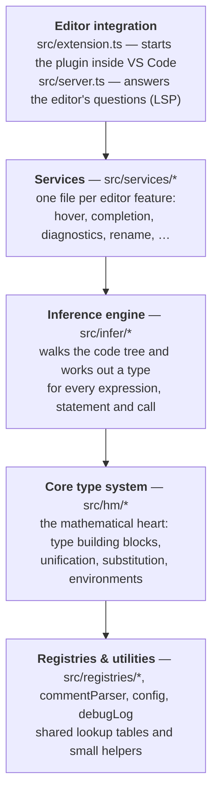

# Architecture — How This Project Is Put Together

> New here? Read [GLOSSARY.md](GLOSSARY.md) first: it explains every technical
> term used below in plain language.

## What this project is, in one paragraph

**HinMil** is a VS Code extension that adds a type checker to plain JavaScript.
You write ordinary JS plus optional type notes in comments
(`// add :: Number -> Number -> Number`), and the extension shows type
information when you hover, offers smart completions while you type, and puts
warning squiggles under code whose types don't match. Under the hood it is a
*language server* built around the classic Hindley–Milner type inference
algorithm.

## The layer cake

The code is organised in layers. Each layer only leans on the layers **below**
it — like floors of a building. That is also the safest order for reading (and
changing) the code: start at the foundation.

## What lives where

| Place | Role (plain language) |
|---|---|
| [src/hm/types.ts](src/hm/types.ts) | The building blocks: how a "type" is stored in memory, plus helpers to create and print them. |
| [src/hm/unify.ts](src/hm/unify.ts) | The puzzle solver: can these two types be made identical? What do the placeholders have to be? |
| [src/hm/substitution.ts](src/hm/substitution.ts) | The answer sheet: remembers what every placeholder turned out to be. |
| [src/hm/env.ts](src/hm/env.ts) | The phone book: which names are in scope, and what type does each have? |
| [src/hm/typeParser.ts](src/hm/typeParser.ts) | Reads a written signature like `Number -> String` and turns it into building blocks. |
| [src/hm/typeUtils.ts](src/hm/typeUtils.ts) | Small pure helpers over types: walking, mapping, comparing, recognising shapes (spread chains, overload slots). |
| [src/infer/index.ts](src/infer/index.ts) | The conductor (`InferenceEngine`): drives one full analysis of a file, delegating to the modules below. |
| [src/infer/expressions.ts](src/infer/expressions.ts) + `expr-*.ts` | Works out the type of every kind of expression (`x + 1`, `obj.field`, `() => …`, …). |
| [src/infer/calls.ts](src/infer/calls.ts) + `call-*.ts` | The hardest part of expressions: function calls. [call-overloads.ts](src/infer/call-overloads.ts) tries the alternatives of an overloaded function; [call-rows.ts](src/infer/call-rows.ts) computes the type-level functions `Picked`, `Merge` and `Awaited`. |
| [src/infer/functionPatterns.ts](src/infer/functionPatterns.ts) | Recognises functional shapes in calls: curry wrappers, curried results, `...` chains (`pipe`, `compose`), callbacks with fewer parameters than offered. |
| [src/infer/unifyDiag.ts](src/infer/unifyDiag.ts) | Unification *with* error reporting: turns "doesn't fit" into a message at the right place, checks the direction of arguments, recovers with the `$error` marker so one mistake gives one message. |
| [src/infer/setupPass.ts](src/infer/setupPass.ts) | The preparation step before any code is read: collects annotations and directives, loads `::types`, aliases and constraints. |
| [src/infer/statements.ts](src/infer/statements.ts) + `stmt-*.ts` | Handles statements: `const`/`let` declarations, `if`, `return`, destructuring, … |
| [src/infer/annotations.ts](src/infer/annotations.ts) + `annotation-*.ts` | Collects the `::` comments, validates them, and checks the code keeps its promises. |
| [src/infer/narrowing.ts](src/infer/narrowing.ts) | Makes types more precise inside `if` branches. |
| [src/infer/modules.ts](src/infer/modules.ts) | Cross-file glue: what does each file export, what do imports mean? |
| [src/registries/](src/registries/) | Global lookup tables: [methodRegistry.ts](src/registries/methodRegistry.ts) (the built-in JavaScript methods and every `Type#method` / `Type.static`), [dataTypeRegistry.ts](src/registries/dataTypeRegistry.ts) (sum types), [constraintRegistry.ts](src/registries/constraintRegistry.ts) (constraints and who satisfies them), [domGlobals.ts](src/registries/domGlobals.ts) (the browser DOM), and [session.ts](src/registries/session.ts) (save/restore all of them at once). |
| [src/parsing.ts](src/parsing.ts) | The only door to the JavaScript parser: turns source text into a syntax tree (with an error-tolerant mode for half-typed files). Parsers plug in as backends — acorn is the shipped default; [src/parsing-babel.ts](src/parsing-babel.ts) is a test-only @babel/parser backend (`HINMIL_PARSER=babel`) that proves the swap works: the whole test suite passes on both. |
| [src/estree.ts](src/estree.ts) | The shared vocabulary of syntax-tree node types (the "ESTree" standard, from `@types/estree`, plus the required `start`/`end` offsets) that the rest of the code imports instead of a concrete parser library. |
| [src/walking.ts](src/walking.ts) | Typed tree traversal (visit every node of a chosen kind), expressed in the shared ESTree vocabulary. |
| [src/commentParser.ts](src/commentParser.ts) | Fishes annotations and directives out of source comments. |
| [src/services/](src/services/) | One file per editor feature — hover, completion, signature help, definitions, references and rename, code actions, document symbols, diagnostics (with [diagnosticCodes.ts](src/services/diagnosticCodes.ts)) — that translates engine results into editor answers. |
| [src/services/importContext.ts](src/services/importContext.ts) | Cross-file inference: analyses imported files on demand, caches their exports, follows sidecars, `::types` and travelling type names, detects cycles, keeps the registries consistent while switching files. |
| [src/services/files.ts](src/services/files.ts) + [fsProbe.ts](src/services/fsProbe.ts) | Module resolution like Node (relative paths, packages, `exports`, sidecars, bundled typings), `.hm` preprocessing, cached file-existence checks. |
| [src/services/hmFileServices.ts](src/services/hmFileServices.ts) | Diagnostics, hover, definition and symbols *in* `.hm` files. |
| [src/services/globalsLoader.ts](src/services/globalsLoader.ts), [fileSelection.ts](src/services/fileSelection.ts), [fileSelectionRefresh.ts](src/services/fileSelectionRefresh.ts) | Project configuration: the globals files of a scope, which files are checked, and which workspace folder a file belongs to. |
| [src/services/documentCache.ts](src/services/documentCache.ts) + [shortCircuit.ts](src/services/shortCircuit.ts) | The language server's per-document caches and the rule for re-using diagnostics of an unchanged text. |
| [src/config.ts](src/config.ts) | Settings and project configuration: defaults, validation, and `findScopeRoot` — which folder's configuration a file belongs to. |
| [src/services/projectChecker.ts](src/services/projectChecker.ts) | Checks files of one project scope outside the editor; the engine behind the CLI. |
| [src/cli.ts](src/cli.ts) | The command-line checker (`hinmil [paths…]`): options, file discovery, one `ProjectChecker` per scope, stylish/JSON output, exit status. |
| [src/server.ts](src/server.ts) | The switchboard: receives editor requests over LSP and routes them to the right service. Keeps the workspace folders (each with its own configuration, settings and file selection; folders can be added and removed) and one *project scope* (globals, import context, engine) per folder with HinMil configuration. |
| [src/extension.ts](src/extension.ts) | The tiny VS Code entry point that launches the server. |

## The story of one hover

What happens when you rest your mouse on a variable:

1. **VS Code** notices the hover and sends a "hover request" (file + cursor
   position) over the Language Server Protocol.
2. **src/server.ts** receives it and looks up the analysed version of that file
   in the document cache (or triggers a fresh analysis).
3. A fresh analysis means the **InferenceEngine** (src/infer/index.ts) parses
   the file into a syntax tree, reads all `::` comment annotations
   (src/commentParser.ts), then walks the whole tree. For every expression it
   asks the expression/call/statement modules to produce a type, using
   **unification** (src/hm/unify.ts) to fit the pieces together and recording
   placeholder answers in the **substitution**.
4. **src/services/hover.ts** finds which expression sits under the cursor,
   asks the engine for its type, applies the substitution so all solved
   placeholders show their final answers, and pretty-prints the result.
5. The server sends the text back, and VS Code shows the popup.

Completions, squiggles, rename and the rest follow the same pattern — only
step 4 differs per feature.

## The story of one import

What happens when `orders.js` says `import { formatAmount } from "./money"`:

1. **The setup pass** ([setupPass.ts](src/infer/setupPass.ts)) sees the
   import and asks the *import resolver* of
   [importContext.ts](src/services/importContext.ts) for `./money`.
2. **Resolution** ([files.ts](src/services/files.ts)) turns the specifier
   into a file, like Node does. For a package it also looks for types, in
   this order (later wins): bundled typings
   ([hm-types-builtin/](hm-types-builtin/)), inline annotations in the
   package's JavaScript, its `.hm` sidecars, a companion `@hm/<pkg>`
   package, and the project's own `hm-types/<pkg>.hm`.
3. **The imported file is analysed** with its own engine run, after the
   shared registries have been saved ([session.ts](src/registries/session.ts));
   they are restored afterwards and the imported file's method and
   constraint registrations are merged in. The result — the *export map* —
   is cached (LRU, 1000 files) until the file changes.
4. **Type names travel along**: the aliases visible in `money.js` (its own,
   its `::types` targets, its imports) become available in `orders.js`.
5. A cycle (`money.js` importing `orders.js`) is detected and reported as a
   warning (HM3005).

The language server keeps this context per *project scope* (a folder with
its own HinMil configuration), the CLI keeps one
[ProjectChecker](src/services/projectChecker.ts) per scope.

## State between files

Most of the engine is pure, but three kinds of state outlive one analysis:

- **Registries are process-wide** (one method registry, one constraint
  registry, …). Every analysis of another file saves and restores them
  through [session.ts](src/registries/session.ts); code that touches them
  outside that path corrupts other files' results.
- **Type objects can be mutated in place** (assigning a property to a
  record-typed namespace extends its record). Caches keyed on type objects
  are therefore unsafe; caches are keyed on files, text or names instead.
- **Caches**: export maps per file ([importContext.ts](src/services/importContext.ts)),
  parsed sidecars and package scans ([files.ts](src/services/files.ts)),
  file-existence probes ([fsProbe.ts](src/services/fsProbe.ts)), per-document
  results and diagnostics in the server
  ([documentCache.ts](src/services/documentCache.ts)), and the workspace
  export index for auto-import completion. A file change invalidates the
  file, every file that imports it, and — for a configuration or globals
  file — every scope: all of them are rebuilt on first use.

## Outside `src/`

| Place | Role |
|---|---|
| [hm-types-builtin/](hm-types-builtin/) | Bundled typings: React, React DOM and Node modules (`fs`, `path`, `crypto`, …). Shipped with the extension and the npm package. |
| [schemas/](schemas/) | JSON schemas for `hinmil.config.json` and the `"hinmil"` key of `package.json` (editor validation and completion). |
| [syntaxes/](syntaxes/) | TextMate grammars that colour annotations in JavaScript and `.hm` files. Edit the `.full` grammar and copy it to the active one; a test checks they are equal. |
| [npm/cli/](npm/cli/) | The npm package of the CLI. Its `prepack` builds the repository and copies `dist/`, the bundled typings, schemas, README and LICENSE into it. |
| [scripts/](scripts/) | `benchmark.ts` (`npm run bench`) and `tarball-test.ts` (`npm run test:tarball`). |
| [sample/](sample/) | Example files referenced by the README; open them in the editor to see the features. |
| [tests/](tests/) | Unit tests per layer (`hm/`, `infer/`, `annotations/`, `modules/`, `services/`, …), end-to-end scenarios in [tests/scenarios/](tests/scenarios/), and fixture projects in [tests/fixtures/scenarios/](tests/fixtures/scenarios/) (each with a README). |

## Safety nets for changing the code

- **Tests**: 260+ test files / 4900+ tests under [tests/](tests/). Run all with
  `npm test`, or a subset with e.g. `npx jest tests/hm`. Realistic,
  end-to-end cases live in [tests/scenarios/](tests/scenarios/) (positive
  and negative).
- **The language server end to end**:
  [tests/services/languageServer.test.ts](tests/services/languageServer.test.ts)
  runs the real `src/server.ts` in-process and talks to it over JSON-RPC
  ([tests/helpers/lspHarness.ts](tests/helpers/lspHarness.ts)): diagnostics,
  hover, completion, definitions, rename, code actions, configuration
  changes and per-folder scopes.
- **Coverage**: `npm run test:coverage`. `jest.config.js` sets a
  `coverageThreshold` just below the measured level; the run fails when
  coverage drops. Raise the threshold when coverage goes up.
- **Published package**: `npm run test:tarball` packs the npm CLI and runs
  it from the extracted tarball in an isolated project.
- **TypeScript strict mode**: `npx tsc --noEmit` catches many mistakes without
  running anything.
- **Benchmarks**: `npm run bench` guards performance of the analysis. Its
  run-to-run noise is 10–20 %: compare builds interleaved (old, new, old,
  new, …) and take the minimum per build. For a change in a hot path
  (`Substitution.apply`, `unify`, member access, calls), measure before and
  after, and compare the diagnostics of a real project too
  (`hinmil --format json`).
- **A bug fix comes with a scenario**: a realistic test (positive and
  negative) that fails without the fix. Check that by disabling the fix
  temporarily; a test that passes either way proves nothing.

When in doubt about order: change the bottom layers first (`hm/`, registries),
verify, then move up. [src/infer/index.ts](src/infer/index.ts) and
[src/server.ts](src/server.ts) touch everything, so change those last.
server.ts is only reached through the in-process LSP tests, so add a case
there when you change a handler.
